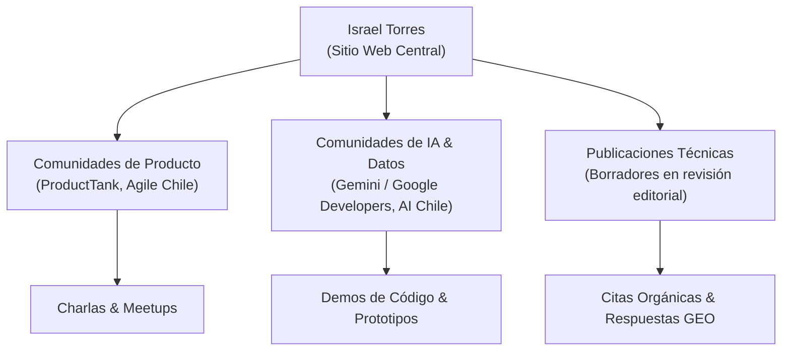

# Plan de Autoridad Digital y Red de Entidades (Entity Authority Plan)
**Entidad Principal:** Israel Torres  
**Sitio Web:** [https://israel-torres-web.vercel.app/](https://israel-torres-web.vercel.app/)  
**Documento:** `docs/seo/ENTITY-AUTHORITY-PLAN.md`  
**Estado:** Revisión Editorial y Factual Final / Rama `seo/growth-3.0`  
**Fecha:** Octubre 2026  

---

## 1. Fundamentos de Autoridad de Entidad (E-E-A-T)

Google evalúa la legitimidad de una persona y su sitio web mediante las señales de **Experiencia, Expertise, Autoridad y Confianza (E-E-A-T)**. Para una presencia personal profesional, la autoridad se construye a través de la **red de correlación semántica**:

```
                       ┌─────────────────────────┐
                       │      Google Index &     │
                       │     Knowledge Graph     │
                       └────────────┬────────────┘
                                    │
           ┌────────────────────────┼────────────────────────┐
           ▼                        ▼                        ▼
┌─────────────────────┐  ┌─────────────────────┐  ┌─────────────────────┐
│    Sitio Web Oficial│  │  Perfiles Oficiales │  │  Ecosistema Externo │
│   israel-torres-web │  │    LinkedIn/GitHub  │  │  USS, Artefact, Acid│
│   (Nodo Primario)   │  │   (Nodos Canónicos) │  │  (Nodos de Respaldo)│
└──────────┬──────────┘  └──────────┬──────────┘  └──────────┬──────────┘
           │                        │                        │
           └────────────────────────┴────────────────────────┘
                       Consenso Factual Unificado
```

Cuando los motores verifican que las afirmaciones de la web oficial coinciden con registros independientes en LinkedIn, GitHub, repositorios de código y registros institucionales, se reduce significativamente el riesgo de atribuciones erróneas o desalineadas en modelos de búsqueda generativa.

---

## 2. Red Canónica de Perfiles (Nodos Primarios `sameAs`)

La entidad `Person` en la web declara dos perfiles canónicos mediante la propiedad `sameAs`. La alineación de estos perfiles debe ser consistente:

### 2.1 LinkedIn (`https://www.linkedin.com/in/israeltorresl`)

LinkedIn constituye el ancla de verificación profesional directa en el ámbito corporativo.

*Recomendaciones de alineamiento editorial:*
1. **Titular Principal (Headline):**
   - *Texto sugerido:* `Ingeniero Civil Industrial | Data Consultant en Artefact | Próximo Senior Product Owner en Acid Labs (Nov 2026) | Estrategia, IA Aplicada & Medios de Pago`
   - *Objetivo:* Coherencia con el `headline` y `positioning` del sitio web.
2. **Enlace en el Perfil de Contacto:**
   - Incorporar `https://israel-torres-web.vercel.app/` en el campo "Sitio web" (categoría Personal / Portafolio).
3. **Acerca de (Summary):**
   - Incorporar la tesis central: *«Estructuro problemas complejos y los convierto en propuestas que se pueden ver, probar e iterar»*.
   - Mencionar los ejes de trabajo: Medios de pago y banca (iniciativas regionales Visa), prototipado rápido con IA y coordinación cross-functional.
4. **Experiencia Laboral:**
   - **Artefact Spanish LATAM:** Data Consultant (Abril 2026 – Presente). Describir iniciativas de customer lifecycle y copilotos comerciales.
   - **Acid Labs:** Próxima incorporación planificada para Noviembre 2026 como Product Owner Senior (presentar como hito futuro planificado sin solapar como empleo simultáneo activo).
5. **Certificaciones:**
   - Incorporar enlaces de verificación pública a las credenciales oficiales una vez disponibles (Google Cloud, Google Project Management, CertiProf).

### 2.2 GitHub (`https://github.com/IsraelTorresIndustrial`)

GitHub representa el respaldo de trabajo técnico, reflejando la práctica de **Vibecoding, ingeniería y prototipado asistido por IA**.

*Recomendaciones de alineamiento editorial:*
1. **Bio del Perfil de GitHub:**
   - *Texto sugerido:* `Ingeniero Civil Industrial | Product Owner & Applied AI Builder. Santiago, Chile.`
   - *URL del sitio web en GitHub:* Configurar `https://israel-torres-web.vercel.app/` en el campo público de URL.
2. **README de Perfil (`IsraelTorresIndustrial/IsraelTorresIndustrial`):**
   - Presentación alineada con la web personal:
     - Enlace al sitio web oficial.
     - Áreas de interés: Arquitecturas RAG, automatización con LLMs, motores declarativos (Python-pptx), herramientas de gestión ágil.
     - Proyectos destacados con enlace a los casos de estudio de la web ([`/proyectos/executive-communication-os`](file:///Users/israeltorres/Documents/GitHub/Israel-Torres-Web/src/routes.ts#L36) y [`/proyectos/copiloto-inteligencia-comercial`](file:///Users/israeltorres/Documents/GitHub/Israel-Torres-Web/src/routes.ts#L36)).
3. **Repositorios Públicos de Demostración:**
   - Mantener públicos repositorios demostrativos de herramientas no confidenciales (utilitarios de formateo, scripts de evaluación de prompts o herramientas de productividad abiertas).

---

## 3. Nodos Institucionales y Académicos de Respaldo

Los motores de búsqueda ponderan con especial solidez las referencias institucionales y académicas:

### 3.1 Universidad San Sebastián (USS)
- **Registro Académico:** Titulado de Ingeniería Civil Industrial y Diplomado en Finanzas completado.
- **Correo Institucional Activo:** `itorresl@correo.uss.cl` (utilizado como punto de contacto formal en el schema y web).
- **Red de Exalumnos:** Participar en el directorio o perfil de egresados de la USS, vinculando el nombre con la web personal y la escuela de ingeniería.
- **Experiencia en Gestión Ágil USS:** Experiencia como Scrum Master coordinando la plataforma de seguimiento de más de 30 equipos simultáneos (2025–2026), documentada en [`/proyectos/seguimiento-agil-multiequipo`](file:///Users/israeltorres/Documents/GitHub/Israel-Torres-Web/src/routes.ts#L36).

### 3.2 Artefact Spanish LATAM (ex-Brain Food)
- **Presencia Corporativa:** Figura en el equipo de consultoría analítica y de datos.
- **Contenidos de Industria:** Oportunidad de coautoría o mención en artículos metodológicos de Artefact sobre medios de pago y consultoría analítica.

### 3.3 Acid Labs (Hito Noviembre 2026)
- **Ecosistema Tech:** Acid Labs cuenta con presencia activa en la comunidad de desarrollo, producto y diseño en Chile y Latinoamérica.
- **Oportunidades Futuras:** Participación en blogs técnicos o meetups de producto a partir de la fecha de inicio efectiva.

---

## 4. Ecosistema de Comunidades Técnicas y Divulgación (Digital PR Ético)

Para incrementar la visibilidad de manera orgánica y sin recurrir a esquemas artificiales, se plantea una pauta basada en aporte técnico:



### 4.1 Comunidades de Producto y Agilidad
- **ProductTank Santiago / Mind the Product:** Participación en discusiones sobre el rol del Product Owner en la adopción de herramientas de IA generativa.
- **Temática Clave:** *«Cómo el prototipado con IA (Vibecoding) reduce la fricción y acelera la comprensión entre negocio e ingeniería»*.

### 4.2 Comunidades de Inteligencia Artificial y Cloud
- **Google Developer Groups (GDG) Santiago / AI Chile:** Exponer sobre el desarrollo de agentes con Gemini Enterprise y metodologías RAG con guardrails y validación factual para sectores corporativos.
- **Aporte Concreto:** Compartir lecciones aprendidas sobre cómo mitigar alucinaciones y estructurar bases de conocimiento curadas.

---

## 5. Matriz de Enlaces Éticos (White-Hat Linking Policy)

Queda descartada cualquier práctica de manipulación de algoritmos (black-hat o grey-hat), tales como:
- Compra de enlaces en granjas de blogs o directorios automáticos.
- Redes privadas de blogs (PBNs).
- Comentarios masivos en foros o blogs externos.

**La política oficial de enlaces de Israel Torres se rige por:**
1. **Enlaces de Atribución Genuina:** Enlaces generados cuando terceros citan los artículos editoriales de la web por su valor metodológico.
2. **Enlaces de Perfiles Verificados:** Plataformas profesionales oficiales (LinkedIn, GitHub, USS, emisores de certificación).
3. **Open Source & Recursos Gratuitos:** Repositorios de GitHub que aportan utilidad práctica y citan la web del autor en su documentación.
4. **Menciones en Eventos:** Enlaces en notas o diapositivas públicas de conferencias y charlas técnicas.

---

## 6. Lista de Verificación de Sincronización de Entidad (Checklist Operativo)

| Plataforma | Elemento a Sincronizar | Estado Requerido | Prioridad |
| :--- | :--- | :--- | :--- |
| **Sitio Web** | Metaetiquetas, Schema.org `Person`, Canonical URL | Desplegado y verificado en Release 1.0 | **Completado** |
| **LinkedIn** | URL oficial en datos de contacto | `https://israel-torres-web.vercel.app/` | **Alta (Acción Manual)** |
| **LinkedIn** | Titular y resumen sincronizado con la web | Mencionar Ing. Civil Industrial, Artefact y Acid Labs (Nov 2026) | **Alta (Acción Manual)** |
| **GitHub** | URL en perfil público | `https://israel-torres-web.vercel.app/` | **Alta (Acción Manual)** |
| **GitHub** | README de perfil destacando proyectos | Enlaces a [`/proyectos/executive-communication-os`](file:///Users/israeltorres/Documents/GitHub/Israel-Torres-Web/src/routes.ts#L36) y [`/proyectos/copiloto-inteligencia-comercial`](file:///Users/israeltorres/Documents/GitHub/Israel-Torres-Web/src/routes.ts#L36) | **Media (Acción Manual)** |
| **Google Cloud** | Credencial de Gemini Enterprise Agent Development | Visibilidad pública de la certificación | **[Pendiente de enlace público]** |
| **USS Alumni** | Registro de egresados actualizado | Titulado en Ing. Civil Industrial + Diplomado | **Baja (Informativo)** |
