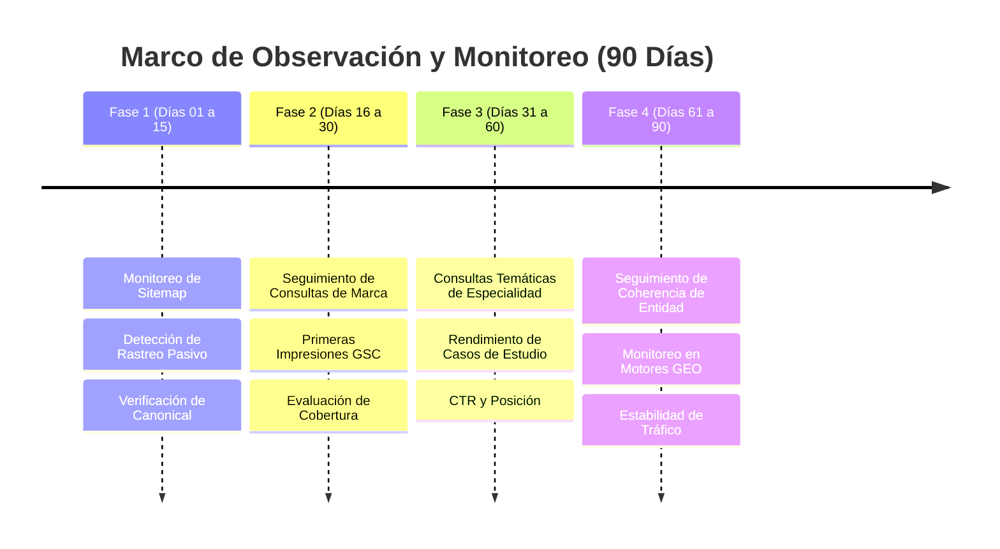

# Roadmap de Monitoreo y Crecimiento en Google Search Console (90 Días)
**Entidad Principal:** Israel Torres  
**Sitio Web:** [https://israel-torres-web.vercel.app/](https://israel-torres-web.vercel.app/)  
**Documento:** `docs/seo/SEARCH-CONSOLE-ROADMAP.md`  
**Estado:** Revisión Editorial y Factual Final / Rama `seo/growth-3.0`  
**Fecha:** Octubre 2026  

---

## 1. Contexto de Indexación y Diagnóstico Inicial

Al 22 de octubre de 2026, el estado técnico de la propiedad en Google Search Console presenta las siguientes condiciones confirmadas:

```
┌─────────────────────────────────────────────────────────────┐
│             ESTADO INICIAL SEARCH CONSOLE                   │
├─────────────────────────────────────────────────────────────┤
│ • Propiedad Verificada: SÍ (Método: Archivo HTML Estático) │
│ • Prueba en Vivo (Live Test): SÍ (URL disponible e indexable)│
│ • Canonical Declarada: https://israel-torres-web.vercel.app/│
│ • Sitemap Declarado: https://israel-torres-web.vercel.app/  │
│                      sitemap.xml (11 URLs canónicas)        │
│ • Rich Results Detectados: BreadcrumbList + ProfilePage     │
│ • Soft-404: Controlado (Rutas inválidas devuelven HTTP 404) │
│ • Limitación Temporal: Cuota diaria de inspección en vivo   │
└─────────────────────────────────────────────────────────────┘
```

> [!NOTE]
> El mensaje de «Cuota diaria superada» corresponde a un límite de tasa (*rate limit*) de la herramienta de inspección interactiva en Search Console y no impide el rastreo pasivo regular de Googlebot. Los motores de búsqueda indexan de forma asíncrona sin plazos fijos garantizados.

---

## 2. Marco de Monitoreo por Fases de Observación (90 Días)

Las fases a continuación no constituyen promesas algorítmicas con plazos fijos, sino **periodos de observación técnica estructurada** para evaluar tendencias y detectar anomalías:



---

### FASE 1: Observación de Indexación y Cobertura Técnica (Días 1 a 15)

- **Foco Principal:** Monitorear el procesamiento del archivo `sitemap.xml` por Googlebot y la evolución del informe de páginas indexadas en Search Console.
- **Actividades de Monitoreo:**
  1. Revisar semanalmente el informe **Páginas (Indexación de páginas)** en Search Console.
  2. Verificar que no se reporten bloqueos inesperados por `robots.txt` ni advertencias de canonical discrepante.
  3. Comprobar que la versión indexada corresponda a la URL HTTPS sin redirecciones anómalas.
- **Pauta Operativa:**
  - *Recomendado:* Monitoreo pasivo cada 48 a 72 horas en el panel de GSC.
  - *Evitar:* Reenvío compulsivo de solicitudes de indexación individual, ya que no acelera el proceso algorítmico y agota la cuota diaria de la herramienta.

---

### FASE 2: Detección Temprana de Consultas de Marca (Días 16 a 30)

- **Foco Principal:** Identificar la aparición de las primeras impresiones orgánicas asociadas al nombre del profesional y sus variantes geográficas.
- **Consultas en Observación:**
  - `Israel Torres`
  - `Israel Torres Chile`
  - `Israel Torres Ingeniero Civil Industrial`
- **Actividades de Monitoreo:**
  1. Revisar en el informe de **Rendimiento** si surgen impresiones para búsquedas geolocalizadas en Chile.
  2. Evaluar el comportamiento del CTR en las impresiones registradas.
  3. Observar la presencia simultánea de la web oficial y los perfiles de LinkedIn y GitHub en los resultados de búsqueda.

---

### FASE 3: Observación de Consultas Temáticas y Casos de Estudio (Días 31 a 60)

- **Foco Principal:** Evaluar si las páginas individuales de proyectos y especialidades comienzan a capturar impresiones vinculadas a sus materias técnicas.
- **Consultas en Observación:**
  - `Israel Torres Product Owner`
  - `Israel Torres Inteligencia Artificial`
  - `Israel Torres Vibecoding`
  - `Israel Torres Medios de Pago`
- **Actividades de Monitoreo:**
  1. Monitorear el rendimiento de las rutas de proyectos principales:
     - [`/proyectos/executive-communication-os`](file:///Users/israeltorres/Documents/GitHub/Israel-Torres-Web/src/routes.ts#L36)
     - [`/proyectos/copiloto-inteligencia-comercial`](file:///Users/israeltorres/Documents/GitHub/Israel-Torres-Web/src/routes.ts#L36)
     - [`/proyectos/crm-customer-lifecycle`](file:///Users/israeltorres/Documents/GitHub/Israel-Torres-Web/src/routes.ts#L36)
  2. Registrar si Google muestra fragmentos enriquecidos correspondientes a los esquemas Schema.org `ProfilePage` o `CreativeWork`.

---

### FASE 4: Seguimiento de Coherencia de Entidad y Motores Generativos (Días 61 a 90)

- **Foco Principal:** Evaluar de forma no intrusiva si las herramientas de búsqueda y los sistemas generativos (AI Overviews, Perplexity) reflejan de manera precisa y desambiguada la trayectoria profesional.
- **Actividades de Monitoreo:**
  1. Realizar consultas de prueba periódicas para observar si los resúmenes generativos atribuyen correctamente la formación y experiencia profesional chilena.
  2. Comprobar la estabilidad de indexación de las 11 rutas públicas en Search Console.
  3. Evaluar la correlación entre las referencias externas legítimas (LinkedIn, GitHub) y la visibilidad de la web oficial.

---

## 3. Matriz de Indicadores de Monitoreo (KPIs de Observación)

Los valores reflejan rangos de observación y seguimiento de tendencia, sin constituir metas contractuales ni garantías algorítmicas:

| Indicador (KPI) | Estado Inicial (Día 0) | Rango de Observación (30 Días) | Rango de Observación (60 Días) | Rango de Observación (90 Días) |
| :--- | :---: | :---: | :---: | :---: |
| **URLs Canónicas Indexadas** | En evaluación | Cobertura en proceso | Tendencia a cobertura total | Cobertura estable |
| **Impresiones Semanales (GSC)** | 0 | Primeras impresiones registradas | Crecimiento gradual | Tendencia consolidada |
| **Clics Semanales (GSC)** | 0 | Clics iniciales de marca | Tráfico exploratorio | Flujo orgánico recurrente |
| **Presencia en `Israel Torres Chile`** | Sin presencia | Detección en SERP local | Mejora progresiva de posición | Posición competitiva local |
| **Reconocimiento en Motores GEO** | No detectado | Respuestas dispersas | Citas con referencia a fuentes públicas | Consistencia de entidad |

---

## 4. Protocolo de Diagnóstico y Contingencia

Ante avisos o comportamientos habituales en Search Console, se aplican las siguientes pautas técnicas:

### Contingencia A: Rastreada pero actualmente sin indexar (Crawled - currently not indexed)
- **Causa Habitual:** El motor prioriza el presupuesto de rastreo hacia sitios con mayor historial acumulado o está procesando la autoridad inicial del dominio.
- **Pauta:** Mantener la estabilidad de las URLs sin alterar rutas ni contenidos apresuradamente. Reforzar la consistencia de los enlaces canónicos en perfiles externos (`sameAs`).

### Contingencia B: Descubierta pero no rastreada (Discovered - currently not indexed)
- **Causa Habitual:** Cola de rastreo en dominios de reciente publicación.
- **Pauta:** No reenviar la URL continuamente. Permitir que el ciclo de rastreo regular de Googlebot procese el sitemap de forma natural.

### Contingencia C: Alerta de Soft 404
- **Diagnóstico Actual:** **Controlado.** La configuración en `vercel.json` y el archivo `public/404.html` aseguran un código de estado estricto HTTP 404 para cualquier ruta inexistente.
- **Pauta de Control:** Ejecutar `npm run seo:check` antes de cualquier pase a producción en futuros despliegues.
