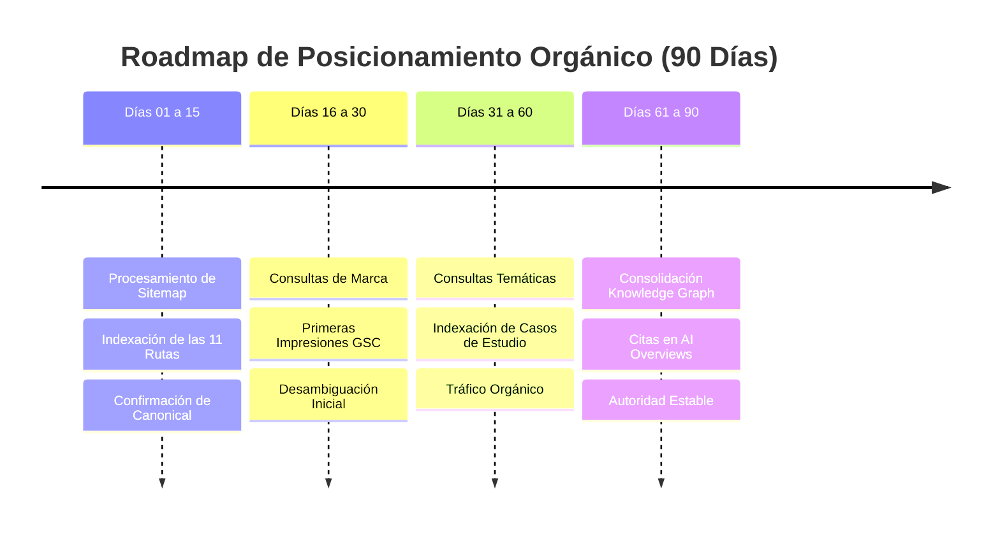

# Roadmap de Monitoreo y Crecimiento en Google Search Console (90 Días)
**Entidad Principal:** Israel Torres  
**Sitio Web:** [https://israel-torres-web.vercel.app/](https://israel-torres-web.vercel.app/)  
**Documento:** `docs/seo/SEARCH-CONSOLE-ROADMAP.md`  
**Estado:** Activo / Rama `seo/growth-3.0`  
**Fecha:** Octubre 2026  

---

## 1. Contexto de Indexación y Diagnóstico Inicial

Al 22 de octubre de 2026, el estado técnico de la propiedad en Google Search Console presenta las siguientes condiciones confirmadas:

```
┌─────────────────────────────────────────────────────────────┐
│             ESTADO INICIAL SEARCH CONSOLE                   │
├─────────────────────────────────────────────────────────────┤
│ • Propiedad Verificada: SÍ (Método: Archivo HTML Estático) │
│ • Prueba en Vivo (Live Test): SÍ (URL disponible e indexable)│
│ • Canonical Declarada: https://israel-torres-web.vercel.app/│
│ • Sitemap Declarado: https://israel-torres-web.vercel.app/  │
│                      sitemap.xml (11 URLs canónicas)        │
│ • Rich Results Detectados: BreadcrumbList + ProfilePage     │
│ • Soft-404: Eliminado (Rutas inválidas responden HTTP 404)  │
│ • Bloqueo Temporal: Cuota diaria de inspección superada     │
└─────────────────────────────────────────────────────────────┘
```

> [!IMPORTANT]
> El mensaje de «Cuota diaria superada» es un límite normal de rate-limiting de la herramienta de inspección interactiva de Search Console y no afecta el rastreo natural ni la indexación orgánica en segundo plano por parte de Googlebot.

---

## 2. Roadmap de 90 Días por Fases Temporales



---

### FASE 1: Estabilización de Indexación y Procesamiento Técnico (Días 0 a 15)

- **Objetivo Principal:** Asegurar que Googlebot procese el archivo `sitemap.xml` y transicione las 11 URLs del estado "Descubierta: actualmente sin indexar" al estado "Indexada".
- **Hitos Operativos:**
  1. Monitoreo diario del informe **Páginas (Indexación de páginas)** en Search Console.
  2. Confirmación de lectura del sitemap sin errores de sintaxis ni bloqueos en `robots.txt`.
  3. Verificación de que la versión canónica indexada sea estrictamente la URL con protocolo HTTPS y sin slash final duplicado.
- **Acciones Permitidas / Prohibidas:**
  - *Permitido:* Comprobar el informe de indexación pasiva en GSC cada 48 horas.
  - *Prohibido:* Reenviar masivamente solicitudes de indexación en la herramienta de inspección (esto resetea colas y gasta cuota innecesariamente).
- **Criterio de Éxito de la Fase 1:** Las 11 URLs prerenderizadas figuran como indexadas válidas en el informe de cobertura.

---

### FASE 2: Emergencia de Consultas de Marca y Desambiguación (Días 16 a 30)

- **Objetivo Principal:** Detección de las primeras impresiones y clics orgánicos para el clúster de marca directa.
- **Consultas Bajo Monitoreo Intensivo:**
  - `Israel Torres`
  - `Israel Torres Chile`
  - `Israel Torres Ingeniero Civil Industrial`
- **Hitos Operativos:**
  1. Verificar en el informe de **Rendimiento** la aparición de impresiones para consultas geolocalizadas (`Chile`).
  2. Analizar el **CTR inicial**: para búsquedas de marca propia, el CTR esperado debe situarse por encima del 15% una vez alcanzada la primera página.
  3. Comprobar que en la SERP de Google la web oficial aparezca acompañada de los perfiles de LinkedIn y GitHub como resultados complementarios o sitelinks.
- **Criterio de Éxito de la Fase 2:** La consulta `Israel Torres Chile` rankea en el Top 5 de Google Chile (google.cl).

---

### FASE 3: Expansión de Consultas Temáticas y Casos de Estudio (Días 31 a 60)

- **Objetivo Principal:** Captura de búsquedas informacionales vinculadas a las áreas de especialidad y los seis proyectos detallados.
- **Consultas Bajo Monitoreo Intensivo:**
  - `Israel Torres Product Owner`
  - `Israel Torres Inteligencia Artificial`
  - `Israel Torres Vibecoding`
  - `Israel Torres Medios de Pago`
  - Términos específicos de proyectos: *Presentation Intelligence OS*, *Copiloto RAG banca*, *Customer Lifecycle medios de pago*.
- **Hitos Operativos:**
  1. Monitorear el rendimiento individual de las páginas de proyectos (`/proyectos/presentation-os`, `/proyectos/commercial-intelligence`, `/proyectos/crm-lifecycle`).
  2. Evaluar el impacto de la incorporación de los artículos editoriales si se activan en producción.
  3. Comprobar si Google asigna fragmentos enriquecidos (rich snippets) basados en los datos estructurados `ProfilePage` y `CreativeWork`.
- **Criterio de Éxito de la Fase 3:** Al menos 3 rutas internas de proyectos generan impresiones orgánicas semanales en Search Console.

---

### FASE 4: Consolidación de Knowledge Graph y Triggers en AI Overviews (Días 61 a 90)

- **Objetivo Principal:** Reconocimiento de Israel Torres como entidad única en el Knowledge Graph de Google y aparición consistente en resúmenes generativos de IA (Google AI Overviews / Gemini Search).
- **Hitos Operativos:**
  1. Realizar pruebas controladas en Google AI Overviews consultando:  
     *«Quién es Israel Torres en Chile»*  
     *«Trayectoria de Israel Torres Ingeniero Civil Industrial»*
  2. Auditar la consistencia de las fuentes citadas por los motores de IA (la web oficial debe figurar como fuente primaria o de corroboración).
  3. Evaluar la estabilidad de la posición orgánica para el nombre propio frente a homónimos internacionales.
- **Criterio de Éxito de la Fase 4:** Los motores generativos sintetizan con precisión la biografía profesional sin atribuir logros de terceros ni omitir su formación e industrias clave.

---

## 3. Matriz de Indicadores Clave de Desempeño (KPIs)

| Indicador (KPI) | Línea Base (Día 0) | Meta a 30 Días | Meta a 60 Días | Meta a 90 Días |
| :--- | :---: | :---: | :---: | :---: |
| **URLs Canónicas Indexadas** | 0 / 11 | 11 / 11 | 11 / 11 (+ artículos si aplican) | 100% de rutas públicas |
| **Impresiones Semanales (GSC)** | 0 | 50 – 150 | 200 – 500 | 500+ |
| **Clics Semanales (GSC)** | 0 | 10 – 30 | 30 – 80 | 100+ |
| **CTR en Consulta `Israel Torres Chile`** | N/D | > 15% | > 25% | > 35% |
| **Posición SERP `Israel Torres Chile`** | Sin rankear | Top 5 | Top 3 | #1 |
| **Posición SERP `Israel Torres` (Chile)** | Sin rankear | Top 20 | Top 10 | Top 5 |
| **Citas en AI Overviews / Perplexity** | 0 | Detección incipiente | Cita con enlace | Entidad reconocida |

---

## 4. Protocolo de Diagnóstico y Contingencia

Ante anomalías comunes en Search Console, se establecen los siguientes cursos de acción estándar:

### Contingencia A: Rastreada pero actualmente sin indexar (Crawled - currently not indexed)
- **Causa Típica:** El algoritmo considera que la página aún no tiene suficiente autoridad acumulada o detecta contenido duplicado con otra versión previa.
- **Acción:** No modificar el HTML ni cambiar URLs. Esperar 10 días para que el índice consolide las señales de los datos estructurados. Si persiste, reforzar los enlaces internos desde `/sobre-mi` y comprobar la ganancia de información (Information Gain).

### Contingencia B: Página descubierta pero no rastreada (Discovered - currently not indexed)
- **Causa Típica:** Restricción de presupuesto de rastreo (crawl budget) en dominios nuevos.
- **Acción:** No reenviar la URL compulsivamente. Verificar que el enlace canónico esté activo en los perfiles `sameAs` de LinkedIn y GitHub para incentivar a Googlebot a seguir el enlace de forma externa y natural.

### Contingencia C: Alerta de Soft 404
- **Diagnóstico Actual:** **Resuelto satisfactoriamente.** La configuración en `vercel.json` y el archivo `public/404.html` devuelven cabecera estricta HTTP 404 para cualquier ruta inexistente.
- **Acción de Mantenimiento:** Si Claude o un nuevo despliegue modifica la configuración de rutas, ejecutar `npm run seo:check` antes de cualquier pase a producción.
