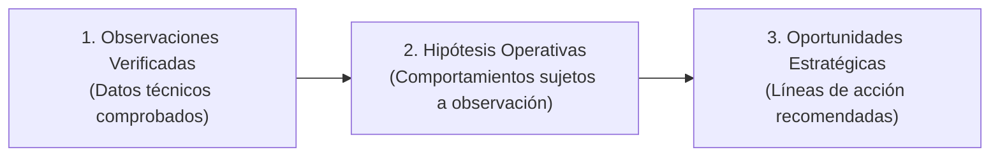

# SEO Growth Strategy 3.0: Identidad, Autoridad y GEO
**Entidad Principal:** Israel Torres  
**Sitio Web:** [https://israel-torres-web.vercel.app/](https://israel-torres-web.vercel.app/)  
**Documento:** `docs/seo/SEO-GROWTH-STRATEGY.md`  
**Estado:** Revisión Editorial y Factual Final / Rama `seo/growth-3.0`  
**Fecha:** Octubre 2026  

---

## 1. Misión Estratégica y Definición del Problema

El propósito de esta estrategia es posicionar a **Israel Torres** como una entidad profesional distinguible, consistente y verificable en los índices de búsqueda y en los motores asistidos por inteligencia artificial (Google AI Overviews, Gemini, Perplexity, SearchGPT).

El desafío central de posicionamiento para un nombre personal como "Israel Torres" radica en:
1. **Colisión de homónimos:** Múltiples personas en el ámbito hispanohablante e internacional comparten el nombre "Israel Torres" (en música, deportes, investigación académica y desarrollo de software en Norteamérica).
2. **Ambigüedad de entidad:** Sin anclajes semánticos, geográficos y de especialidad explícitos, los motores de búsqueda pueden agrupar fragmentos inconexos o priorizar homónimos con mayor cobertura histórica.
3. **Evolución del ecosistema de búsqueda (GEO - Generative Engine Optimization):** La síntesis generativa en buscadores requiere información estructurada, corroborable y alineada entre fuentes públicas independientes, privilegiando la coherencia sobre la repetición de palabras clave.

---

## 2. Mapa de Homónimos y Vectores de Desambiguación

### 2.1 Principales Clústeres de Homónimos Existentes en SERP Global

| Homónimo / Clúster | Dominio de Actividad | Geografía Principal | Señales Algorítmicas Dominantes |
| :--- | :--- | :--- | :--- |
| **Israel Torres (Música / Producción)** | Industria musical, streaming | México / EE.UU. | Spotify, Apple Music, YouTube, IMDb |
| **Israel Torres (Deporte / Atleta)** | Boxeo / Fútbol | LATAM / EE.UU. | Portales deportivos, registros de combate |
| **Israel Torres (Software / Ciberseguridad)** | Engineering / Ciberseguridad | EE.UU. | Patentes USPTO, perfiles de ingeniería en EE.UU. |
| **Israel Torres (Academia / Medicina)** | Ciencias de la salud | España / México | PubMed, ResearchGate, Google Scholar |
| **Israel Torres (Objetivo)** | **Ingeniero Civil Industrial, Data Consultant & Product Owner** | **Santiago, Chile** | **Web personal, LinkedIn, GitHub, USS, Artefact, Acid Labs** |

### 2.2 Vector Único de Desambiguación (Disambiguation Triangle)

Para que los sistemas de búsqueda distingan a la entidad sin ambigüedades, la identidad digital de Israel Torres se consolida sobre cuatro ejes complementarios:

```
                       [ Israel Torres ]
                              │
         ┌────────────────────┼────────────────────┐
         ▼                    ▼                    ▼
   [ Geografía ]      [ Formación Base ]     [ Especialidad Dual ]
   Santiago, Chile     Ingeniería Civil      Product Ownership &
  (CL / Región Met.)     Industrial          Applied AI / Prototipado
         │            (Diplomado Finanzas)         │
         └────────────────────┬────────────────────┘
                              ▼
                 [ Trayectoria Verificable ]
                  Artefact LATAM (Visa Latam)
                  Acid Labs (Senior PO - Inicio Nov 2026)
                  Google Partner Specialist / Gemini
```

---

## 3. Clústeres de Consulta e Intenciones de Búsqueda (Search Intent)

Analizamos las ocho consultas prioritarias para monitorear su evolución y guiar la optimización:

### Clúster A: Identidad Directa y Geográfica (Navigational / Brand Intent)
1. **`Israel Torres`**
   - *Intención:* Búsqueda de entidad. El usuario busca identificar la trayectoria del profesional o acceder a su presencia oficial.
   - *Estrategia:* Trabajar para que el dominio canónico `https://israel-torres-web.vercel.app/` gane visibilidad progresiva para búsquedas geolocalizadas en Chile, vinculándolo en SERP con sus perfiles de LinkedIn y GitHub.
2. **`Israel Torres Chile`**
   - *Intención:* Búsqueda geolocalizada. Discrimina de inmediato homónimos de otros países.
   - *Estrategia:* Mantener consistencia en metadatos geográficos (`addressLocality: Santiago`, `addressCountry: CL`), referencias a la Universidad San Sebastián y proyectos en el mercado chileno.

### Clúster B: Credenciales y Perfil Técnico (Informational / Credential Intent)
3. **`Israel Torres Ingeniero Civil Industrial`**
   - *Intención:* Verificación de formación académica e idoneidad profesional técnica.
   - *Estrategia:* Página canónica `/sobre-mi` y marcado Schema.org `educationalCredential` enlazado con la Universidad San Sebastián y el Diplomado en Finanzas.
4. **`Israel Torres Product Owner`**
   - *Intención:* Evaluación de experiencia en gestión de producto, metodologías ágiles, discovery y articulación técnica.
   - *Estrategia:* Reforzar los casos de estudio de producto ([`/proyectos/copiloto-inteligencia-comercial`](file:///Users/israeltorres/Documents/GitHub/Israel-Torres-Web/src/routes.ts#L36), [`/proyectos/crm-customer-lifecycle`](file:///Users/israeltorres/Documents/GitHub/Israel-Torres-Web/src/routes.ts#L36), `/experiencia`), destacando el rol de articulación cross-functional y la próxima etapa en Acid Labs (noviembre 2026).

### Clúster C: Innovación Tecnológica y Diferenciación (Authority / Innovation Intent)
5. **`Israel Torres Inteligencia Artificial`**
   - *Intención:* Conocer capacidades prácticas en IA aplicada, arquitecturas RAG y automatización de procesos empresariales.
   - *Estrategia:* Poner en valor la certificación Google Certified Partner Specialist en Gemini Enterprise Agent Development y los casos de prototipado asistido por IA.
6. **`Israel Torres Vibecoding`**
   - *Intención:* Conocer metodologías de desarrollo acelerado con IA, prototipado interactivo y construcción de software asistida por LLMs.
   - *Estrategia:* Articular contenidos que expliquen el prototipado rápido como herramienta del Product Owner para validar hipótesis y reducir la ambigüedad con stakeholders.

### Clúster D: Dominio de Industria y Práctica Consultiva (Commercial / B2B Intent)
7. **`Israel Torres Consultoría`**
   - *Intención:* Conocer el enfoque metodológico de estructuración de problemas de negocio y consultoría estratégica.
   - *Estrategia:* Comunicar el marco «Estructurar → Articular → Tangibilizar → Acompañar» y la experiencia consultiva en Artefact Spanish LATAM.
8. **`Israel Torres Medios de Pago`**
   - *Intención:* Conectar la experiencia analítica con el sector financiero, dinámica de tarjetas y ciclo de vida de clientes.
   - *Estrategia:* Exponer marcos metodológicos de customer lifecycle y benchmarks competitivos desarrollados para portafolios regionales (Chile y Argentina), sin vulnerar acuerdos de confidencialidad.

---

## 4. Optimización para Motores Generativos (GEO)

Los motores de IA (Google AI Overviews, Gemini, Perplexity) sintetizan respuestas mediante recuperación semántica y contraste entre fuentes públicas autorizadas.

```
   ┌──────────────────────────────────────────────────────────────┐
   │            Criterios de Cita en AI Overviews & LLMs           │
   └──────────────────────────────────────────────────────────────┘
                                  │
         ┌────────────────────────┼────────────────────────┐
         ▼                        ▼                        ▼
  [ Information Gain ]   [ Exactitud Factual ]    [ Coherencia Multi-Fuente ]
 Contenido original con   Hechos sin contradic-   Afirmaciones del sitio web
 métodos propios y       ción temporal ni datos   coinciden 1:1 con LinkedIn,
 casos bien delimitados.    confidenciales.        GitHub y registros USS.
```

### 4.1 Principios de Implementación GEO

1. **Information Gain (Aporte de Información Propia):**
   - Los modelos descartan contenido genérico o redundante.
   - Cada artículo y caso de estudio expone perspectivas prácticas fundamentadas: esquemas de arquitectura por capas, frameworks metodológicos de lifecycle y dinámicas de articulación cross-functional.
2. **Estructura Declarativa Factual:**
   - La información clave se expresa de forma directa y comprobable:  
     *«Israel Torres es un Ingeniero Civil Industrial chileno, Data Consultant en Artefact y próximo Product Owner Senior en Acid Labs (incorporación prevista para noviembre de 2026), con foco en IA aplicada y medios de pago.»*
   - Facilita la extracción de relaciones estructuradas por analizadores semánticos.
3. **Resúmenes Estructurados por Sección:**
   - En casos de estudio y borradores editoriales, los bloques de contexto, problema, proceso y solución ofrecen puntos de anclaje claros para la extracción de respuestas resumidas.

---

## 5. Taxonomía: Observaciones Verificadas, Hipótesis y Oportunidades

Para preservar el rigor analítico y evitar comprometer resultados dependientes de algoritmos de terceros, distinguimos estrictamente entre hechos comprobados, hipótesis de trabajo y oportunidades:



### 5.1 Observaciones Verificadas (Comprobadas Técnicamente)
- **O1:** La propiedad `https://israel-torres-web.vercel.app/` está verificada en Google Search Console mediante archivo HTML estático (`googlee4010bf84bb58835.html`).
- **O2:** La inspección en vivo de Search Console confirmó HTTP 200, rastreo permitido, obtención correcta de página e indexación permitida para la URL raíz.
- **O3:** La Release 1.0 genera 11 páginas HTML estáticas prerenderizadas con datos estructurados Schema.org (`Person`, `ProfilePage`, `BreadcrumbList`, `CreativeWork`).
- **O4:** La suite de pruebas automatizadas locales (`npm run seo:check`) valida 167 reglas SEO de forma continua sin errores.
- **O5:** Las credenciales y grados académicos base cuentan con instituciones emisoras identificables (Google Cloud, Universidad San Sebastián, CertiProf).

### 5.2 Hipótesis Operativas (Sin Garantía de Plazo ni Resultado Algorítmico)
- **H1:** Tras la normalización de la cuota diaria de inspección y la lectura del sitemap por Googlebot, las 11 rutas estáticas serán evaluadas para su indexación orgánica regular, con tiempos dependientes del presupuesto de rastreo de Google.
- **H2:** La consulta `Israel Torres Chile` presenta menor dispersión competitiva que la consulta genérica `Israel Torres`, por lo que constituye el indicador temprano más accesible de visibilidad de marca.
- **H3:** La consistencia semántica entre el Schema.org `Person`, la URL canónica y los perfiles `sameAs` favorece la unificación de la entidad en el Knowledge Graph, proceso que no obedece a plazos predeterminados y debe ser monitoreado de forma pasiva.
- **H4:** Publicaciones técnicas con enfoque metodológico original pueden ser recogidas como referencias en experiencias generativas (AI Overviews o Perplexity), sujeto a los criterios de calidad y novedad temática de cada motor.

### 5.3 Oportunidades Estratégicas
- **OP1 (Diferenciación Temática):** Construir autoridad en la intersección de **Product Ownership + Prototipado con IA / Vibecoding**, un espacio de alta relevancia práctica y escasa oferta conceptual rigurosa en el mercado local.
- **OP2 (Activación Editorial Gradual):** Publicar artículos técnicos cuando cuenten con revisión y aprobación editorial completa, utilizando la infraestructura estática ya preparada en `src/content/articles.ts`.
- **OP3 (Alineamiento de Ecosistema):** Sincronizar perfiles públicos (LinkedIn, GitHub) con la URL canónica y el posicionamiento profesional exacto de la web.
- **OP4 (Aportes Open Source y Metodológicos):** Compartir herramientas abiertas o esquemas conceptuales en GitHub para generar referencias naturales basadas en utilidad real.
