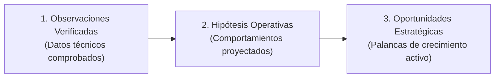

# SEO Growth Strategy 3.0: Identidad, Autoridad y GEO
**Entidad Principal:** Israel Torres  
**Sitio Web:** [https://israel-torres-web.vercel.app/](https://israel-torres-web.vercel.app/)  
**Documento:** `docs/seo/SEO-GROWTH-STRATEGY.md`  
**Estado:** Activo / Rama `seo/growth-3.0`  
**Fecha:** Octubre 2026  

---

## 1. Misión Estratégica y Definición del Problema

El propósito de esta estrategia es consolidar a **Israel Torres** como una entidad profesional única, inconfundible y de alta autoridad en el grafo de conocimiento de Google (Google Knowledge Graph) y en los motores de búsqueda asistidos por inteligencia artificial (Google AI Overviews, Gemini, Perplexity, SearchGPT).

El desafío central de posicionamiento para un nombre personal como "Israel Torres" radica en:
1. **Colisión de homónimos:** Decenas de personas en el mundo hispanohablante y angloparlante comparten el nombre "Israel Torres" (músicos, deportistas, investigadores académicos, ejecutivos de software en EE.UU. y México).
2. **Ambigüedad de entidad:** Sin anclajes semánticos, geográficos y de especialidad robustos, los algoritmos de búsqueda tienden a clasificar las consultas de marca como genéricas o agrupar fragmentos inconexos.
3. **Evolución del ecosistema de búsqueda (GEO - Generative Engine Optimization):** La búsqueda ya no depende únicamente de metaetiquetas y densidad de palabras clave; los LLMs sintetizan respuestas extrayendo información estructurada, corroborable y consensuada entre fuentes públicas autorizadas.

---

## 2. Mapa de Homónimos y Vectores de Desambiguación

### 2.1 Principales Clústeres de Homónimos Existentes en SERP Global

| Homónimo / Clúster | Dominio de Actividad | Geografía Principal | Señales Algorítmicas Dominantes |
| :--- | :--- | :--- | :--- |
| **Israel Torres (Músico / Productor)** | Industria musical, streaming | México / EE.UU. | Spotify, Apple Music, YouTube, IMDb |
| **Israel Torres (Atleta / Deporte)** | Deportes / Boxeo / Fútbol | LATAM / EE.UU. | Wikipedia, BoxRec, portales deportivos |
| **Israel Torres (Tech / Software EE.UU.)** | Ciberseguridad / Engineering | EE.UU. (California/Texas) | Patentes USPTO, LinkedIn EE.UU., GitHub |
| **Israel Torres (Académico)** | Medicina / Ciencias Biológicas | España / México | PubMed, ResearchGate, Google Scholar |
| **Israel Torres (Objetivo)** | **Ingeniero Civil Industrial, Data Consultant & Product Owner** | **Santiago, Chile** | **Web personal, LinkedIn, GitHub, USS, Artefact, Acid Labs** |

### 2.2 Vector Único de Desambiguación (Disambiguation Triangle)

Para que los motores distingan inequívocamente a la entidad, la identidad digital de Israel Torres se construye sobre una intersección de 4 nodos que **ningún otro homónimo comparte**:

```
                       [ Israel Torres ]
                              │
         ┌────────────────────┼────────────────────┐
         ▼                    ▼                    ▼
   [ Geografía ]      [ Formación Base ]     [ Especialidad Dual ]
   Santiago, Chile     Ingeniería Civil      Product Ownership &
  (CL / Región Met.)     Industrial          Applied AI / Vibecoding
         │            (Diplomado Finanzas)         │
         └────────────────────┬────────────────────┘
                              ▼
                 [ Trayectoria Verificable ]
                  Artefact LATAM (Visa Latam)
                  Acid Labs (Senior PO - Nov 2026)
                  Google Partner Specialist / Gemini
```

---

## 3. Clústeres de Consulta e Intenciones de Búsqueda (Search Intent)

Analizamos las 8 consultas prioritarias requeridas para estructurar su captura de tráfico orgánico y desambiguación:

### Clúster A: Identidad Directa y Geográfica (Navigational / Brand Intent)
1. **`Israel Torres`**
   - *Intención:* Búsqueda de entidad pura. El usuario busca confirmar quién es, acceder a su sitio oficial o perfil profesional.
   - *Estrategia:* Consolidar el dominio canónico `israel-torres-web.vercel.app` en el Top 3 orgánico para búsquedas originadas en Chile, y emparejarlo en SERP con su LinkedIn y GitHub.
2. **`Israel Torres Chile`**
   - *Intención:* Búsqueda geolocalizada. Filtra inmediatamente homónimos internacionales.
   - *Estrategia:* Coherencia absoluta en `addressLocality: Santiago`, `addressCountry: CL`, referencias a la Universidad San Sebastián e industria financiera local. Posición objetivo: #1 absoluto.

### Clúster B: Credenciales y Perfil Técnico (Informational / Credential Intent)
3. **`Israel Torres Ingeniero Civil Industrial`**
   - *Intención:* Verificación de idoneidad técnica, formación y seniority analítico. Típico de evaluadores de talento, clientes corporativos y socios estratégicos.
   - *Estrategia:* Página dedicada `/sobre-mi` y marcado Schema `educationalCredential` enlazado con la Universidad San Sebastián y su Diplomado en Finanzas.
4. **`Israel Torres Product Owner`**
   - *Intención:* Exploración de trayectoria en gestión de producto, metodologías ágiles, discovery y delivery digital.
   - *Estrategia:* Posicionar casos de estudio con impacto en producto (`/proyectos/commercial-intelligence`, `/proyectos/crm-lifecycle`, `/experiencia`) destacando el rol de articulación estratégica y la próxima etapa en Acid Labs (noviembre 2026).

### Clúster C: Innovación Tecnológica y Diferenciación (Authority / Innovation Intent)
5. **`Israel Torres Inteligencia Artificial`**
   - *Intención:* Identificar capacidad real en IA aplicada, RAG, agentes y automatización empresarial frente al humo del mercado.
   - *Estrategia:* Destacar la certificación Google Certified Partner Specialist en Gemini Enterprise Agent Development, los proyectos de RAG bancario y frameworks de narrativa ejecutiva.
6. **`Israel Torres Vibecoding`**
   - *Intención:* Explorar la vanguardia del desarrollo acelerado con IA, prototipado funcional y construcción autónoma de herramientas de software sin intermediación lenta.
   - *Estrategia:* Capitalizar este término de alta diferenciación y baja competencia mediante artículos de fondo sobre flujos de desarrollo ágil con IA (Claude Code, Antigravity, LLM-assisted pipelines).

### Clúster D: Dominio de Industria y Práctica Consultiva (Commercial / B2B Intent)
7. **`Israel Torres Consultoría`**
   - *Intención:* Conocer su método de consultoría estratégica, resolución de problemas y entrega de valor corporativo.
   - *Estrategia:* Resaltar el framework "Estructurar → Articular → Tangibilizar → Acompañar" y la experiencia en Artefact Spanish LATAM y Brain Food.
8. **`Israel Torres Medios de Pago`**
   - *Intención:* Conectar la experiencia analítica con el sector financiero, adquirencia, emisión de tarjetas, lifecycle de clientes y analítica transaccional.
   - *Estrategia:* Proyectos de tarjetas de crédito/débito para Chile y Argentina, articulación entre negocio bancario, data science y campañas de activación.

---

## 4. Estrategia de Optimización para Motores Generativos (GEO)

Los motores de IA (Google AI Overviews, Gemini Search, Perplexity Pro, SearchGPT) no indexan palabras clave aisladas; ensamblan respuestas mediante **recuperación semántica profunda** y **consenso entre fuentes autorizadas**.

```
   ┌──────────────────────────────────────────────────────────────┐
   │            Criterios de Cita en AI Overviews & LLMs           │
   └──────────────────────────────────────────────────────────────┘
                                  │
         ┌────────────────────────┼────────────────────────┐
         ▼                        ▼                        ▼
  [ Information Gain ]   [ Exactitud Factual ]    [ Coherencia Multi-Fuente ]
 Contenido original con   Hechos sin contradic-   Afirmaciones del sitio web
 datos propios, método   ción temporal ni datos   coinciden 1:1 con LinkedIn,
 único y casos reales.      confidenciales.        GitHub y registros USS.
```

### 4.1 Principios de Implementación GEO para Israel Torres

1. **Information Gain (Ganancia de Información):**
   - Los LLMs descartan resúmenes genéricos que repiten lo que ya está en Wikipedia o blogs masivos.
   - Cada artículo y caso de estudio de Israel Torres expone **mecanismos propios**: diagramas de arquitectura de 4 capas, taxonomías bancarias concretas, frameworks de lifecycle en 4 etapas y metodologías de prototipado rápido.
2. **Estructura Declarativa Factual (Fact-First Writing):**
   - En lugar de introducciones ambiguas, los textos comienzan con afirmaciones fácticas directas:  
     *«Israel Torres es un Ingeniero Civil Industrial chileno, Data Consultant en Artefact y próximo Product Owner Senior en Acid Labs (noviembre 2026), especializado en IA aplicada y medios de pago.»*
   - Facilita la extracción de triplets de conocimiento: `(Israel Torres) - [is] -> (Ingeniero Civil Industrial)` y `(Israel Torres) - [worksAt] -> (Artefact)`.
3. **Micro-formato de Cita Resumida (TL;DR / Key Takeaways):**
   - En cada caso de estudio y futuro artículo editorial, se incluye un bloque estructurado de conclusiones que los scrapers de IA pueden citar textualmente como respuesta enriquecida.

---

## 5. Taxonomía de Hallazgos: Observaciones, Hipótesis y Oportunidades

Para garantizar el máximo rigor técnico y distinguir la realidad comprobada de las expectativas, clasificamos los elementos estratégicos en tres categorías estrictas:



### 5.1 Observaciones Verificadas (Hechos Comprobados al 22 de Octubre de 2026)
- **O1:** La propiedad `https://israel-torres-web.vercel.app/` está formalmente verificada en Google Search Console mediante archivo HTML estático (`googlee4010bf84bb58835.html`).
- **O2:** La inspección en vivo de Search Console confirmó HTTP 200, rastreo permitido, obtención correcta de página e indexación permitida para la URL raíz.
- **O3:** La arquitectura Release 1.0 despliega 11 páginas HTML estáticas prerenderizadas con Schema.org (`Person`, `ProfilePage`, `BreadcrumbList`, `CreativeWork`).
- **O4:** La suite de pruebas automatizadas locales (`npm run seo:check`) valida 167 reglas SEO de forma continua sin regresiones.
- **O5:** Las credenciales profesionales clave están respaldadas por emisores verificables (Google Cloud, Universidad San Sebastián, CertiProf).

### 5.2 Hipótesis Operativas (Comportamientos Proyectados de los Algoritmos)
- **H1:** Tras la resolución de la cuota diaria de Search Console y el procesamiento del sitemap, Google completará el rastreo de las 11 rutas estáticas en un ciclo de 7 a 21 días.
- **H2:** La consulta `Israel Torres Chile` rankeará en primera página antes que la consulta genérica `Israel Torres`, debido al menor volumen competitivo del modificador geográfico.
- **H3:** La combinación de Schema.org `Person` con `@id` unificado y perfiles canónicos `sameAs` provocará la creación de un clúster de entidad único en el Knowledge Graph en un lapso de 60 a 90 días.
- **H4:** Artículos editoriales especializados sobre "Vibecoding", "RAG determinístico" y "Customer Lifecycle en Medios de Pago" capturarán posiciones en AI Overviews dentro de los primeros 45 días de su publicación estática.

### 5.3 Oportunidades Estratégicas de Alto Impacto
- **OP1 (Diferenciación Temática Inmediata):** Posicionarse como el referente chileno en la intersección de **Product Ownership + Vibecoding / IA Aplicada**. Muy pocos profesionales en el país han formalizado esta combinación con casos reales y arquitectura verificable.
- **OP2 (Publicación de Artículos Editoriales):** Activar la sección `/articulos` utilizando la infraestructura ya programada en `src/content/articles.ts`, comenzando con 3 borradores estratégicos de alta densidad conceptual.
- **OP3 (Optimización de Ecosistema Externo):** Alinear la red de perfiles periféricos (LinkedIn, GitHub, USS) para que citen de vuelta la URL canónica y utilicen exactamente la misma formulación de entidad.
- **OP4 (Repositorios Públicos de Open Source):** Publicar utilitarios de código o plantillas metodológicas en GitHub (`IsraelTorresIndustrial`) para generar enlaces naturales de autoridad técnica hacia la web.
